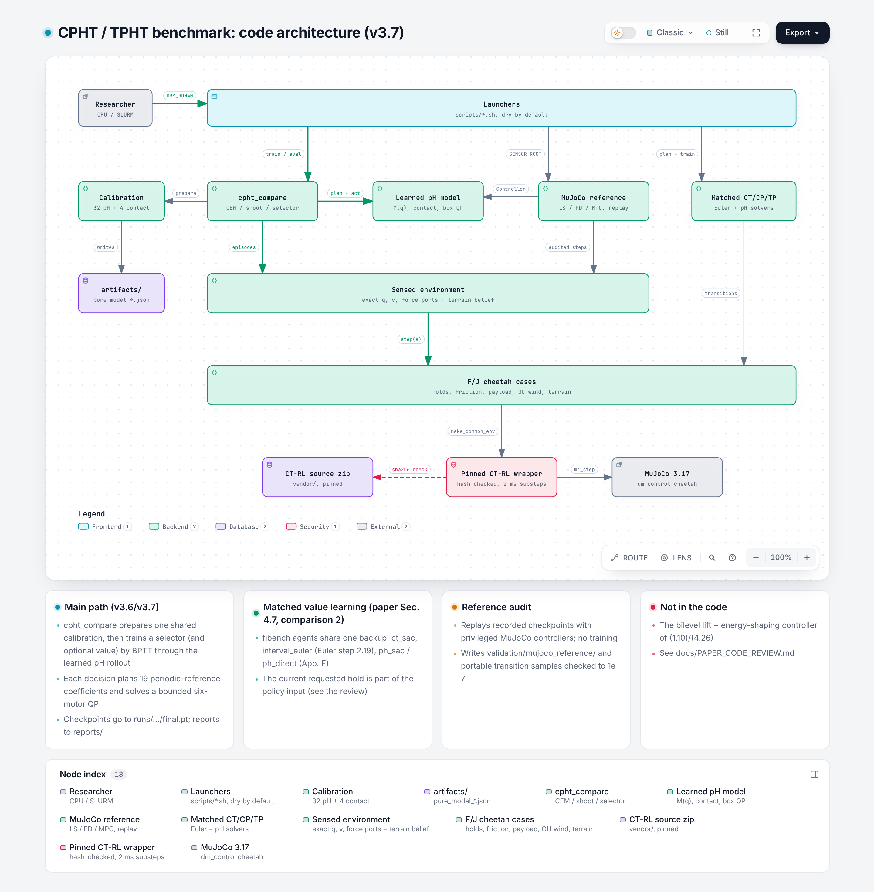

# CPHT: learned port-Hamiltonian dynamics as an RL engine for the DMC cheetah

This repository holds the experiment code for the manuscript **Controlled
SDEs, Measurements and Verified Learning** (the "TPHT revision"). One
pipeline runs it end to end:

1. **Sense and measure.** The cheetah is measured through joint states and
   constraint-force ports, plus a causal terrain/friction belief and optional
   noisy terrain rays.
2. **Calibrate.** An instrumented calibration fits a port-Hamiltonian model
   H = ½pᵀM(q)⁻¹p + U(q) with positive inertia, damping and contact parameters.
3. **Learn through the model.** That pH model becomes the engine the policy
   learns through: gait search (CEM, gradient shooting) or a neural selector
   trained by backpropagation through imagined held-action rollouts,
   optionally with a learned task value.
4. **Act.** A bounded six-motor feedback QP turns the selected motion into
   commands.

A model-free **CT-SAC** baseline is trained under the same sensors,
calibration data and decision budget. Evaluation is paired across fixed and
irregular action clocks, hidden friction changes, sensor shifts and F-to-J
course transfer.

```bash
./run_experiments.sh smoke        # every stage, under a minute on a CPU
./run_experiments.sh pilot        # a small real comparison (hours on a CPU)
./run_experiments.sh full         # prints the paper-scale plan; add "all" to run it
```

> **Before you run an experiment for the paper, read
> [`docs/PAPER_CODE_REVIEW.md`](docs/PAPER_CODE_REVIEW.md).** Where the code
> implements a paper equation, it implements it correctly. The full bilevel
> structured controller (1.10)/(4.26) is not implemented yet, and the Table 1
> wind/payload variants are not part of this pipeline.

## Architecture



Open [`docs/architecture/cpht-architecture.html`](docs/architecture/cpht-architecture.html)
in a browser for the interactive version. It was generated with
[Archify](https://github.com/tt-a1i/archify) from this repository's source,
and every box links to the file and lines it summarizes. Its JSON source is
`docs/architecture/cpht-architecture.json`.

## Install

Use Python 3.11 or 3.12. Install a Torch build that fits your hardware first,
then:

```bash
python -m pip install -r requirements.txt
```

Keep the pinned `mujoco==3.17.0`: the recorded transition replays in
`validation/` are tied to it. For headless runs the launcher sets
`MUJOCO_GL=egl`, which needs a system EGL library (on Ubuntu:
`libegl1 libgl1-mesa-dri`). On Python 3.13, `labmaze` has no wheel; install
`dm-control==1.0.50` with `--no-deps`, since the cheetah suite does not need it.

On first use, `bench/protocol.py` extracts the hash-checked CT-RL source to
`vendor/extracted/`. It refuses to run if that copy has been edited.

## Run the experiment

```bash
./run_experiments.sh [smoke|pilot|full] [plan|prepare|gradcheck|train|eval|report|verify|all]
```

| Scale | Training runs | Decisions per run | Use |
| --- | --- | --- | --- |
| `smoke` | 10 | 68 | checks every stage; ranks nothing |
| `pilot` | 10 | 6,096 | first real comparison, one seed |
| `full` | 156 | 100,000 | paper protocol: 2 cases × 3 seeds × 2 sensing modes × 3 horizons × 4 pH methods + CT-SAC |

Results go to `reports/<scale>.json` and `reports/<scale>.md`; runs and
calibrations go to `runs/<scale>/` and `artifacts/<scale>/`. Environment
variables such as `METHODS`, `SEEDS`, `CASES`, `DEVICE=cuda` and `RESUME=1`
select part of a scale or continue a run. `DISCLOSE_HOLDS=1` reruns with the
hold visible to policies, as an ablation.

[`docs/EXPERIMENTS.md`](docs/EXPERIMENTS.md) describes every stage, sensing
mode, method, evaluation condition and output.
[`docs/DIFFERENTIABLE_CPHT.md`](docs/DIFFERENTIABLE_CPHT.md) gives the
equations of the pH engine.

## Check the installation

```bash
MUJOCO_GL=egl python -m pytest -q tests     # 65 tests, about 30 s on 4 CPU cores
./run_experiments.sh smoke verify
```

`verify` does three things. It replays four recorded real cheetah transitions
bit-for-bit and checks M q̈ + c = τ + J_cᵀ f. It runs `tools/paper_checks.py`,
which checks the manuscript's equations against the code and MuJoCo and prints
each as PASS, DIFF or FAIL. With `SENSOR_ROOT` set, it also runs the privileged
MuJoCo reference controllers on existing trained checkpoints
([`docs/MUJOCO_REFERENCE.md`](docs/MUJOCO_REFERENCE.md)).

## Where the paper lives in the code

| Paper | Code |
| --- | --- |
| §1.5: cheetah task, F/J cases, observations | `fjbench/config.py`, `fjbench/environment.py`, `fjbench/path_task.py` |
| §2.2, (2.8), (4.31): physics substep, held actions, two-tail hold law | `bench/protocol.py`, `bench/env.py` (pinned CT-RL wrapper in `vendor/`) |
| §2.6: unannounced holds | `physical_fj/mechanics.py::announced_hold` |
| App. A, (2.3), (2.31): articulated mechanics, H = ½pᵀM⁻¹p + U | `pure_cpht/mechanics.py`, `physical_fj/mechanics.py` |
| (2.32), §3.6, App. B/C: contact and terrain | `pure_cpht/contact.py`, `fjbench/contact.py`, `fjbench/terrain.py` |
| §3.1, §4.7: sensing and belief assimilation | `environment_belief/` |
| §4.1, §4.6: calibration of the pH model | `physical_fj/prepare.py`, `pure_cpht/learning.py` |
| (4.30): bounded six-motor action | `pure_cpht/feedback.py`, `pure_cpht/controller.py` |
| Learning through the pH model (imagination, BPTT, TD(λ)) | `cpht_compare/rollout.py`, `cpht_compare/learning.py`, `cpht_compare/controller.py` |
| (2.26): CT-SAC baseline | `cpht_compare/baseline.py`, `physical_fj/learner.py`, `physical_fj/train.py` |
| (2.19), App. F.1: Euler value step and pH value solver (reference implementations) | `bench/operators.py` |
| (2.33)–(2.35): held MuJoCo transition, implicit damping, replay | `mujoco_reference/transition.py` |

## Repository layout

```text
run_experiments.sh     the single launcher
experiments/           smoke.json, pilot.json, full.json
cpht_compare/          runner: stages, pH-engine methods, CT-SAC adapter, paired evaluation, report
pure_cpht/             learned pH mechanics, contact closure, bounded feedback controller
physical_fj/           instrumented environment, calibration, CT-SAC learner
environment_belief/    causal terrain/friction belief and sensor timing
fjbench/               F/J task configuration, terrain courses, path task, video recording
bench/                 pinned CT-RL protocol and wrapper, actor network, reference operators
mujoco_reference/      reference controllers and exact transition replay (used by verify)
tools/paper_checks.py  paper-equation cross-check (used by verify)
tests/                 unit and integration tests
validation/            recorded evidence: replay samples, gradient checks, reports
prechecks/             small model fixture used by tests
vendor/                pinned CT-RL source archive (hash-checked)
third_party/           SuperMimic-Reproduced attribution and MIT license
docs/                  guides, the paper review, the architecture diagram
```

Earlier runners (the v1–v3.5 matched value learners, actor-free `pure_cpht`
training, physical-feature SAC, standalone sensing, contact and path-speed
benchmarks) and their documentation were removed in v3.8. They remain in git
history at commit `a0fc5bf`.

## Validation evidence

`validation/` keeps the evidence that shipped with v3.7: the four portable
transition samples with their compiled models, gradient checks, smoke and
half-second comparison reports, and the full-course MuJoCo reference results.
The full-course reference comparison ran 20 episodes without training; in all
of them, the 12 s course timed out before completion (see
`validation/mujoco_reference/report.md`).

## License

GPL-3.0 (see `LICENSE`). `third_party/supermimic_reproduced/` keeps the MIT
notice for the adapted SuperMimic-Reproduced patterns.
`vendor/ct-rl-source.zip` is the pinned upstream CT-RL source. It ships
without a license file, so confirm that redistribution is allowed before
publishing this repository.
